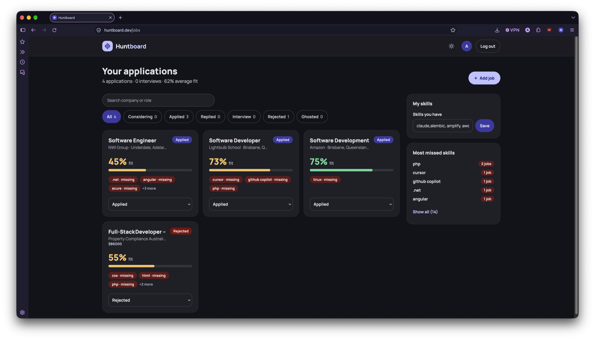
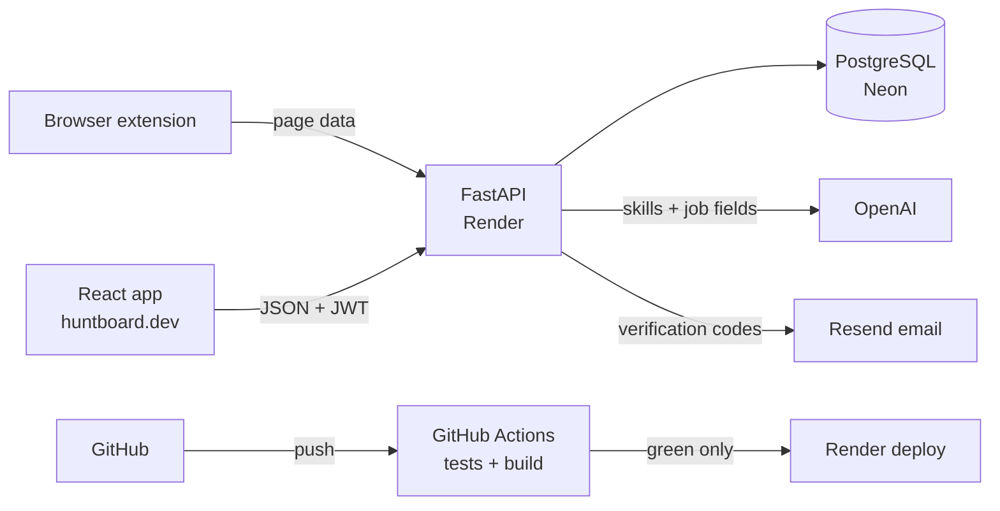

# Huntboard

[](https://github.com/archillexx/job_tracker/actions/workflows/ci.yml)

A job tracker for developers: save jobs from SEEK, LinkedIn or Indeed in one click, track each application's status, and see your fit score and skill gaps at a glance.

**Live:** [huntboard.dev](https://huntboard.dev) · **Firefox extension:** signed, shared as an `.xpi` (see [The browser extension](#the-browser-extension))



## Why I built this

While applying for jobs, I had no proper way to keep track of my applications. When a company called, I often didn't know which role it was for or where that application stood. A spreadsheet helped a little, but it meant a lot of manual work, and I still lost track of things.

A spreadsheet can hold the company, role and status, but I'd still type in the skills and details myself — and it can't tell me how well I fit each job or what I'm missing. Huntboard pulls the required skills out of each job description automatically and gives me a fit score and a skill-gap view against my own skills. Scoring against the exact resume I sent is next.

After that, I want it to read my emails and update an application's status when a company replies, so I don't track that by hand either.

## What it does

- **One-click saving** from SEEK, LinkedIn, Indeed and company careers pages with a browser extension — company, role, location and salary filled in for you to check.
- **AI skill extraction** from every job description, with a **fit score** and the **skills you're missing** for each role.
- **Most-missed skills** across all your applications, so you know what to learn next.
- **Status tracking** (Considering → Applied → Replied → Interview → Rejected / Ghosted), filters and search.
- **Accounts:** email verification, change password (logs out your other sessions), forgot password — each user only ever sees their own data.

## How the AI part works

**Reading a job page** (`backend/jobposting.py`) tries the cheapest, most reliable source first:

1. **Structured data** — many sites embed a schema.org `JobPosting` for search engines. Plain code maps it to fields: no AI, can't hallucinate.
2. **The text you selected** on the page, read by the AI.
3. **The whole visible page**, trimmed, read by the AI with a prompt built to ignore menus, "similar jobs" and job boards' estimated salaries.

The AI returns a Pydantic schema where every field may be `null` — "not stated" instead of a guess — with one retry and a clear failure path. Skills always come from a separate extraction step (`backend/extraction.py`) whose prompt keeps only **named technologies** (React, PostgreSQL, Docker), not practices or soft skills, followed by name normalisation.

**Measured, not eyeballed.** `backend/eval_pages.py` runs the real reader on a hand-labelled golden set of job pages (`backend/tests/fixtures/pages/`):

| Measure | Result |
|---|---|
| Company, role, location | **9 / 9** correct (structured data + two noisy AI pages, one 27,000 characters long) |
| Skills recall | **1.00** — nothing missed |
| Skills precision | **0.96** — the one disagreement: the model lists app stores as skills; my labelling rule doesn't |

It's a small set (3 pages) — enough to catch real problems, not a benchmark. The first run's main finding was in my own answer key: most "invented" skills were genuinely in the ads.

## Architecture



## Tech stack

- **Backend:** Python, FastAPI, SQLAlchemy, Alembic, PostgreSQL, Pydantic, pytest
- **AI:** OpenAI Responses API with structured outputs
- **Auth:** Argon2 (pwdlib), JWT (PyJWT), email one-time codes via Resend
- **Frontend:** React, React Router, Tailwind CSS, Vite
- **Extension:** Manifest V3, plain JavaScript (Firefox and Chrome)
- **Infrastructure:** Render (API + static site), Neon (Postgres), GitHub Actions CI, custom domain with DKIM/SPF/DMARC

## What I learned

- **Measuring AI instead of trusting it.** I built a small golden set of real job pages with answers I wrote by hand, then scored the extraction with precision and recall. The first run taught me the answer key can be wrong too: most "invented" skills were actually in the ads, so I fixed the key from the pages — never to raise the score.
- **Fit-score and skill-gap logic.** I wrote the scoring myself: normalising skill names so "ReactJS" and "react" match, set operations for what's matched and missing, and counting my most-missed skills across every application.
- **Authentication from scratch.** Argon2 password hashing, signed JWTs, email verification codes (hashed, expiring, attempt-limited, committed before rejecting), and logging out other sessions when a password changes.
- **Deploying for real, and working with AI under rules.** A clean-install test caught a missing dependency before production did; migrations run on deploy; CI gates every release. I built Huntboard with an AI pair under a written rule file ([CLAUDE.md](CLAUDE.md)) that set which parts I write myself — so I can explain every line.

## How it was built

I wrote the parts I'd need to explain in an interview: the fit score and skill-gap logic, the skill-extraction prompt and its retry handling, and skill-name normalisation (`backend/scoring.py`, `backend/extraction.py`). An AI pair wrote the application around them — API routes, database models, React UI, auth, deployment — and, by an explicit exception recorded in [CLAUDE.md](CLAUDE.md), the browser extension feature. Every change was reviewed and committed by me.

## The browser extension

`extension/` is a Manifest V3 extension. It reads a page **only when you click its icon**, sends the page to Huntboard's own API, and shows the fields for you to check before saving. It asks for minimal permissions (the active tab, storage, and the Huntboard API host).

- **Firefox:** signed by Mozilla and shared as an `.xpi` — drag it into Firefox to install.
- **Chrome / Edge:** load the `extension/` folder unpacked from `chrome://extensions` (Developer mode).

## Run it locally

You'll need Python 3.14, Node 26 and PostgreSQL.

```sh
# Backend
cd backend
python -m venv .venv && source .venv/bin/activate
pip install -r requirements.txt
cp .env.example .env            # fill in DATABASE_URL, JWT_SECRET, OPENAI_API_KEY (RESEND_API_KEY optional)
createdb job_tracker && createdb job_tracker_test
alembic upgrade head
fastapi dev main.py             # http://127.0.0.1:8000/docs

# Frontend (another terminal)
cd frontend
npm ci
npm run dev                     # http://localhost:5173
```

Without `RESEND_API_KEY`, verification codes are printed in the backend terminal instead of emailed.

## Tests

```sh
cd backend && python -m pytest -q     # 82 tests; runs on every push in CI
python eval_pages.py                  # the extraction evaluation (makes real AI calls)
```

## Roadmap

- Score each job against the resume I actually sent (PDF upload)
- Ask questions across all saved jobs with retrieval-augmented generation (RAG), with a measured retrieval hit rate
- Read replies from Gmail and suggest status changes
